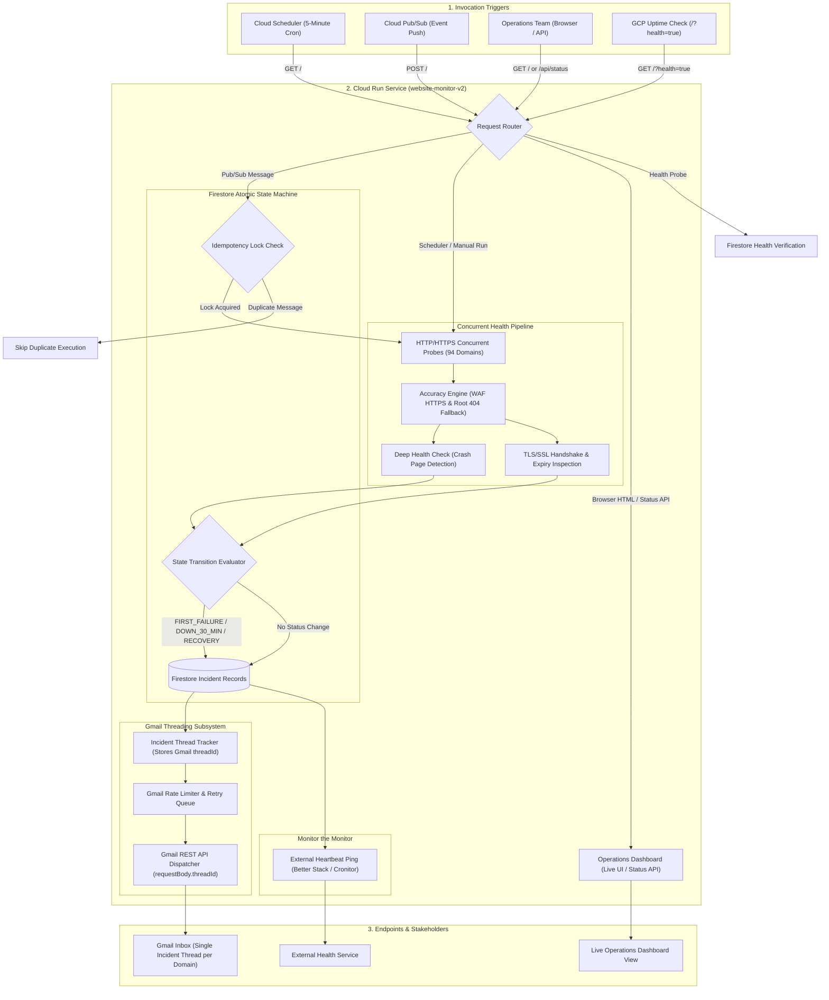

# Enterprise Website Monitor V2 - Production Operations Guide

A resilient, serverless, automated website health monitoring and incident notification platform built on Google Cloud Platform (GCP). It monitors enterprise endpoints in parallel, evaluates state transitions in an atomic NoSQL database, and dispatches threaded incident alerts through the Gmail API.

---

## 1. System Architecture

The platform operates entirely on serverless Google Cloud services, scaling down to zero when idle and executing concurrent health checks every 5 minutes under Cloud Scheduler automation.



---

## 2. Core Operational Capabilities

### A. Gmail API Threading Engine (Single Trail Per Incident)
*   **Exact Thread Linking:** When an initial outage occurs (`FIRST_FAILURE`), the Gmail API returns a unique `threadId`. The engine persists this ID in Firestore.
*   **Automated Thread Attachment:** When the service recovers (`RECOVERY`) or reaches a 30-minute escalation (`DOWN_30_MINUTE`), the engine passes the original `threadId` directly inside `requestBody.threadId` of the Gmail REST API call, alongside standard RFC 2822 `In-Reply-To` and `References` headers.
*   **Result in Inbox:** Every incident lifecycle (Initial Outage -> 30-Minute Escalation -> Recovery) is neatly grouped into the **exact same conversation thread** in your inbox.
*   **Per-Domain Isolation:** Every domain has a dedicated subject line format (`Website Down - domain.com` and `Re: Website Down - domain.com`). Mails from different websites never merge into each other.

### B. High-Precision Accuracy Engine (Zero False Alarms)
*   **Two-Strike Confirmation:** Momentary network blips do not trigger alerts. The system automatically retries failed endpoints after a 1.5-second pause before confirming failure.
*   **Automatic HTTPS Upgrade on WAF Blocks:** Modern corporate Web Application Firewalls (WAFs) frequently block port 80 HTTP requests with `503 Service Unavailable` or `406 Not Acceptable`. If an HTTP endpoint fails or returns a status code >= 400, the probe automatically re-attempts over HTTPS port 443. If HTTPS returns 200 OK, the site is classified as UP.
*   **Root Domain Fallback on 404 Paths:** If an outdated sub-path returns `404 Not Found`, the engine automatically probes the root domain (`https://hostname/`). If the root domain is active and healthy, the host server is verified as operational rather than dead.
*   **Enterprise Authentication Handling:** HTTP status codes `401 Unauthorized`, `403 Forbidden`, and `405 Method Not Allowed` are classified as `UP` because the target application server is actively responding and enforcing security policies.

### C. Prominent HTTP Status Code Reporting
*   Every email notification contains a dedicated, styled **HTTP Status Code** badge:
    *   `503 Service Unavailable`
    *   `502 Bad Gateway`
    *   `500 Internal Server Error`
    *   `404 Not Found`
    *   `200 OK`
*   For non-HTTP network socket disruptions where no response headers were returned, the system explicitly reports:
    *   `None (Connection Timeout)`
    *   `None (DNS Resolution Failure)`
    *   `None (Connection Refused)`

### D. Outage Duration Math
*   Upon recovery, the system calculates the exact total downtime duration from the initial failure timestamp (`Total Downtime: 14m 20s`) and highlights it prominently in the recovery alert.

### E. TLS / SSL Certificate Lifecycle Tracking
*   Concurrently evaluates SSL handshakes on port 443.
*   Calculates exact days remaining until certificate expiration and records the calendar expiry date.
*   Dispatches proactive warning emails when expiration falls within 14 days (rate-limited to once per 24 hours per domain).

---

## 3. Email Alert Formats

### Outage Notification (`FIRST_FAILURE`)
*   **Subject:** `Website Down - compliance.jindalsteel.com`
*   **Top Badge:** `CRITICAL OUTAGE | HTTP 503`
*   **Key Facts Table:**
    *   **Status:** `DOWN`
    *   **HTTP Status Code:** `[ 503 Service Unavailable ]`
    *   **SSL Certificate:** `Valid (42 days left, Expires: 4 Dec 2026)`
    *   **Response Time:** `412 ms`
    *   **Detected At:** `23 Oct 2026, 11:30:15 am (IST)`
    *   **Technical Detail:** `HTTP status 503`

### Recovery Notification (`RECOVERY` - In Exact Same Thread)
*   **Subject:** `Re: Website Down - compliance.jindalsteel.com`
*   **Top Badge:** `SERVICE RESTORED | HTTP 200 OK`
*   **Key Facts Table:**
    *   **Status:** `RECOVERED`
    *   **HTTP Status Code:** `[ 200 OK ]`
    *   **Total Downtime:** `14m 20s`
    *   **SSL Certificate:** `Valid (42 days left, Expires: 4 Dec 2026)`
    *   **Recovery Latency:** `185 ms`
    *   **Detected At:** `23 Oct 2026, 11:44:35 am (IST)`

---

## 4. Quick Start: 1-Click Universal Deployment

> [!NOTE]
> For a full, beginner-friendly step-by-step installation guide from project creation to Gmail OAuth setup, see [SETUP.md](file:///c:/Users/Administrator/Desktop/GCP_Functions/SETUP.md).

Deploy to any Google Cloud Platform account using the automated deployment scripts:

### Prerequisites:
1. Google Cloud SDK (`gcloud` CLI) installed and logged in (`gcloud auth login`).
2. An active GCP project with billing enabled.

### On Linux / macOS / WSL:
```bash
# 1. Clone repository and copy configuration template
cp .env.example .env

# 2. Fill in your environment values in .env
nano .env

# 3. Execute the deployment script
chmod +x deploy.sh
./deploy.sh
```

### On Windows PowerShell:
```powershell
# 1. Clone repository and copy configuration template
Copy-Item .env.example .env

# 2. Fill in your environment values in .env
notepad .env

# 3. Execute the deployment script
.\deploy.ps1
```

The script automatically executes the entire provisioning lifecycle:
1. Sets the active GCP project.
2. Enables required Cloud APIs (`run`, `firestore`, `cloudscheduler`, `gmail`).
3. Provisions the Firestore Native database (`website-monitor-v2`).
4. Creates least-privilege IAM Service Accounts with necessary roles.
5. Builds and deploys the Cloud Run container.
6. Updates the service environment variables.
7. Creates or updates the Cloud Scheduler 5-minute automated cron job.
8. Outputs the live operations dashboard URL.

---

## 5. Configuration Reference (`.env`)

| Variable | Description | Required | Example Value |
| :--- | :--- | :--- | :--- |
| `GOOGLE_CLOUD_PROJECT` | GCP Project ID | Yes | `gcp-image-export-poc` |
| `GCP_REGION` | GCP deployment region | Yes | `asia-south2` |
| `FIRESTORE_DATABASE_ID` | Firestore Native database identifier | Yes | `website-monitor-v2` |
| `COLLECTION_NAME` | Firestore collection storing URL status records | Yes | `website_monitoring` |
| `GMAIL_SENDER` | Email address sending incident notifications | Yes | `monitor@gmail.com` |
| `GMAIL_SENDER_NAME` | Sender display name | No | `Website Operations Monitor` |
| `ALERT_RECIPIENTS` | Comma-separated list of alert recipient emails | Yes | `devops@company.com,lead@company.com` |
| `GMAIL_OAUTH_CLIENT_ID` | OAuth 2.0 Web Client ID from Google Cloud Console | Yes | `123456789-abc.apps.googleusercontent.com` |
| `GMAIL_OAUTH_CLIENT_SECRET` | OAuth 2.0 Client Secret | Yes | `GOCSPX-abc123xyz` |
| `GMAIL_OAUTH_REFRESH_TOKEN` | OAuth 2.0 Refresh Token authorized for Gmail send scope | Yes | `1//0g7...` |
| `SSL_EXPIRY_THRESHOLD_DAYS` | Threshold in days to trigger SSL expiry warning alert | No | `14` |
| `HEARTBEAT_URL` | Optional external health ping URL (Better Stack / Cronitor) | No | `https://betterstack.com/ping/...` |

---

## 6. GCP Services Used and Technical Rationale

1. **Google Cloud Run (Compute Engine):**
   * *Rationale:* Runs containerized Node.js runtime serverlessly. Scales down to zero instances when idle. Computing charges are incurred only during the active checking cycle (~35 seconds per 5 minutes), fitting comfortably within the GCP monthly free tier.
2. **Google Cloud Scheduler (Cron Trigger):**
   * *Rationale:* Serverless cron scheduling service. Issues an HTTP GET request to Cloud Run every 5 minutes (`*/5 * * * *`), eliminating the need to maintain a persistent background server.
3. **Google Cloud Firestore (Atomic State Machine):**
   * *Rationale:* Serverless NoSQL document database. Firestore transactions provide ACID consistency, ensuring status evaluations, downtime calculations, and alert locks never suffer from race conditions or duplicate sends during parallel runs.
4. **Google Gmail REST API (Alert Dispatch):**
   * *Rationale:* Transmits high-deliverability HTML alerts directly from an authorized Gmail account using OAuth 2.0 refresh tokens, bypassing external third-party transactional mail providers.

---

## 7. Understanding Monitored Endpoints (Public vs Intranet)

In an enterprise environment monitoring dozens of endpoints, target URLs generally fall into two categories:

### Public Enterprise Endpoints (Monitored Normally)
* Endpoints accessible over the public internet (e.g. `https://compliance.jindalsteel.com`, `https://hr.jspl.com/`, `https://audit.jindalsteel.com`).
* When these endpoints encounter issues (HTTP 500, 502, 503, 504, or timeout), the system detects the failure and alerts your operations team immediately.

### Private Corporate Intranet Endpoints
* Endpoints that resolve only through internal corporate DNS servers or inside an on-premise office network / VPN (e.g., `crm-uat`, `crmdmstally`, `crmsfa`).
* Because Cloud Run operates on Google's public cloud infrastructure, querying these domains returns `DNS resolution failed (Domain does not exist or private intranet)`.
* These endpoints should either be connected via Serverless VPC Access to your corporate network, or excluded from public cloud monitoring to avoid false alarms.

---

## 8. Live Operations Dashboard & HTTP Endpoints

The Cloud Run deployment exposes an operations dashboard and API:

*   **Live Operations Dashboard:** `GET /` (with browser `Accept: text/html`)
    *   Displays real-time health cards (UP, DOWN, PENDING, Errors).
    *   Live search bar with instant filtering by hostname or status.
    *   Color-coded badges, response latency indicators, and SSL certificate expiration badges.
*   **JSON Status API:** `GET /api/status`
    *   Returns complete structured JSON containing all monitored domains, status codes, response times, and SSL details.
*   **System Health Check:** `GET /?health=true` or `GET /healthz`
    *   Verifies database connectivity and returns service status (`200 OK` for healthy, `503 Service Unavailable` for degraded). Compatible with GCP Cloud Monitoring Uptime Checks.

---

## 9. Troubleshooting Guide for Developers

### Problem 1: Alerts are not being sent
* **Cause:** The Gmail OAuth Refresh Token has expired or lacks the `https://www.googleapis.com/auth/gmail.send` scope.
* **Resolution:** Re-run the local authorization script `get_refresh_token.js` to obtain a fresh refresh token, update `GMAIL_OAUTH_REFRESH_TOKEN` in `.env`, and execute `./deploy.sh`.

### Problem 2: An active website shows as DOWN with status 503 or 406
* **Cause:** The URL was configured with plain `http://` instead of `https://`, and the enterprise WAF blocks port 80 requests.
* **Resolution:** Update the URL to `https://` in `MONITORED_DOMAINS`. The engine's built-in auto-upgrade rule also attempts HTTPS fallback automatically.

### Problem 3: Outdated sub-paths return 404
* **Cause:** An application URL path (e.g. `/GatepassPortal` or `/AR6/login.action`) was renamed or retired on the server.
* **Resolution:** The engine automatically verifies the root domain (`https://host/`). If the root domain returns 200 OK, the host is kept active. You can also update the specific endpoint path in `index.js`.

### Problem 4: Resetting database history to fresh baseline
* **Action:** To clear all old incident histories, message IDs, and flags from Firestore, run:
```bash
wsl bash -c "node -e 'const admin = require(\"firebase-admin\"); const { getFirestore } = require(\"firebase-admin/firestore\"); admin.initializeApp(); const db = getFirestore(admin.app(), \"website-monitor-v2\"); db.collection(\"website_monitoring\").get().then(s => Promise.all(s.docs.map(d => d.ref.delete()))).then(() => console.log(\"Cleaned\"));'"
```

---

## 10. Operational Best Practices

1. **Keep Secrets Out of Version Control:** Always verify that `.env`, `client_secret*.json`, and `token.json` are listed in `.gitignore`.
2. **Rate Limit Protection:** Do not decrease `GMAIL_MIN_SEND_INTERVAL_MS` below 1500 ms; Gmail enforces strict per-minute quota limits on API mail dispatching.
3. **Multi-Recipient Delivery:** Specify all team email addresses inside `ALERT_RECIPIENTS` separated by commas. The system transmits to all recipients in a single unified message, preserving the exact same conversation thread for all team members.
